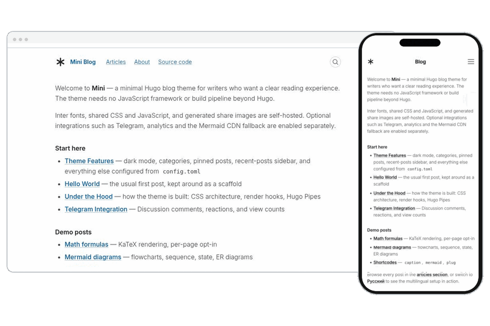

# Hugo Mini

[](https://github.com/zavarovkv/hugo-mini/releases)
[](https://github.com/zavarovkv/hugo-mini/actions/workflows/test-example-site.yml)
[](https://github.com/zavarovkv/hugo-mini/blob/main/LICENSE)

A writer-first Hugo theme for fast, multilingual personal blogs.

Clean typography, self-hosted assets, dark mode, SEO, and optional Telegram integration — without a frontend framework.

The reading foundation comes from [Beauty.css](https://github.com/zavarovkv/beauty-css), pinned and
bundled locally with the theme's own styles. No additional installation is required.

**[Live demo](https://zavarov.com/)** · **[Hugo Themes](https://themes.gohugo.io/themes/hugo-mini/)** · **[Quick start](#quick-start)** · **[Documentation](#documentation)**



## Why Mini

- **Made for reading.** The interface stays out of the way and gives articles room to breathe.
- **Fast by default.** CSS, JavaScript, and fonts are bundled, fingerprinted, and served from your domain.
- **Useful without a plugin stack.** Dark mode, multilingual navigation, feeds, search metadata, math, diagrams, and sharing are included.
- **Easy to grow.** Design tokens, template hooks, named blocks, and custom menu icons cover common extensions.

Add `` to your homepage content to list the three newest articles automatically. Optional `archive` and `archiveLabel` parameters add a link below the list. See [content options](docs/content.md) for details.

The [`project` shortcode](docs/content.md#projects) displays a linked project name and a short description in the same minimal style. Optional `beauty-note` source links sit close to their description, with a larger gap between projects.

Custom pages can use the static [`loading-skeleton` state](docs/customization.md#loading-values) while fetching inline values; it preserves content space and follows the active theme.

[Reading lists](docs/content.md#reading-lists) display site-owned book data in a compact two-column table with ordinary blog typography. Titles and authors can be localized while reading dates, ratings and review references remain shared. Recent book additions can update the New badge on both the book and its collection article.

Add [`github-stars`](docs/content.md#github-stars) inside a description for a GitHub link with a subtle star count, fetched before the build and rendered without browser requests.

Use [`columns` and `column`](docs/content.md#columns) to place content blocks side by side on desktop and stack them on mobile.

Use [`wavy-arrow`](docs/content.md#wavy-arrow) for a thin inline SVG arrow between dates or other text.

Set [`params.notFoundYoda = true`](docs/configuration.md#parameters) for an illustrated 404 page with a character-scan animation that respects reduced-motion preferences. The decorative figure fits the page without an internal scroll area.

## Quick start

Hugo Extended 0.146 or newer is required.

```bash
hugo new site myblog
cd myblog
git submodule add https://github.com/zavarovkv/hugo-mini.git themes/hugo-mini
```

Replace `hugo.toml` with a minimal configuration:

```toml
baseURL = "https://example.com/"
title = "My Blog"
theme = "hugo-mini"
enableRobotsTXT = true

[permalinks]
  blog = "/:slug/"

[params]
  authorName = "Jane Doe"
  authorURL = "https://example.com/"

[markup.goldmark.renderer]
  unsafe = true

[[menu.main]]
  name = "Articles"
  url = "/blog/"
  weight = 1
```

Create the blog section and your first article:

```bash
hugo new content blog/_index.md
hugo new content blog/hello-world.md
hugo server -D
```

Open `http://localhost:1313/`. For a ready-to-run reference, see the [example site](https://github.com/zavarovkv/hugo-mini/tree/main/exampleSite).

## What is included

| Area | Built in |
| --- | --- |
| Writing | Markdown, build-time typography, optional heading links and CSS classes, code copy, captions, KaTeX, Mermaid |
| Reading | Responsive 720 px reading measure, system-aware dark mode, recent posts, pinned posts |
| Discovery | Open Graph images, JSON-LD, `hreflang`, RSS, JSON Feed, `llms.txt` |
| Integrations | Telegram comments and reactions, social sharing, optional analytics |

Features that add weight are opt-in. KaTeX and Mermaid load only on pages that request them; analytics and Telegram are absent until configured.

Without JavaScript, mobile navigation remains visible as ordinary links. The overlay initializes hidden without a loading flash, and closes on Escape, link selection or keyboard focus leaving the navigation.

Mermaid diagrams render as they approach the viewport. Their source stays readable when JavaScript is disabled or loading fails. An optional local ESM bundle loads only the diagram types in use, with a content-hashed entry URL to invalidate stale browser caches after upgrades; see [configuration](docs/configuration.md). Local Markdown images receive intrinsic dimensions to reserve space while loading.

Mermaid 11 and 12 use explicit Dagre/classic settings and the previous flowchart label widths,
so switching a self-hosted bundle to v12 preserves the established layout. Mermaid 12 requires
Node.js 22.12+ and ES2024-capable browsers (Safari 17.4+); the default CDN fallback remains on v11.

## Reading and typography

Articles use 16 px body text and a reading measure of up to 720 px, narrowing to
fit smaller screens. Beauty.css owns the shared typography; the theme sets its
reading-width token and supplies the layout and self-hosted Inter fonts.

Hugo applies typography during the build, without an additional package or
browser script. Goldmark supplies smart quotes, ellipses and dash substitutions.
The theme adds language-aware spacing in Russian and English page bodies:
`1 000 000` keeps its digit groups together, `16px` becomes `16 px`, and percentages
use `10 %` in Russian and `10%` in English. Russian text also keeps a spaced em
dash with the preceding word.

Sources stay unchanged. Code, formulas, URLs and HTML attributes are preserved.
Set `typography = false` in a page's front matter or under site `[params]` to
disable the theme's spacing pass. Goldmark's punctuation settings are separate.
See [typography](docs/typography.md) for examples, exclusions and fragment-level
control.

## Is Mini a good fit?

Choose Mini if you want a text-led personal site or blog, prefer Hugo over a JavaScript application, and want sensible defaults with a small surface for customization.

It is probably not the right starting point for a magazine homepage, a visual portfolio, or a site that needs a component library and application-style interactions.

## Everyday configuration

Most sites only need a few parameters:

```toml
[params]
  favicon = "images/favicon.png"
  avatar = "images/avatar.webp"
  avatarHover = "images/avatar-hover.webp"
  copyrightYear = 2024
  recentSidebarCount = 8
  socialSharing = true

  [params.social]
    telegram = "https://t.me/janedoe"
    github = "https://github.com/janedoe"
    email = "jane@example.com"
```

Posts use TOML front matter:

```toml
+++
title = "My first post"
date = 2026-08-17
description = "A short summary for listings and search results."
categories = ["notes"]
pinned = false
math = false
mermaid = false
+++
```

Set `hidden = true` to keep a page out of listings and feeds while leaving its URL public. Use Hugo's `draft = true` when a page must not be published.

For a publication date known only to the month, use the first day in `date`
and set `date_precision = "month"` to display a localized month name and year.
Other articles retain the full day, month and year regardless of their age.

Set `backToTop = false` in front matter to omit the back-to-top control and its event handlers on a page. The same option under `[params]` applies site-wide.

For a custom share card, add `layouts/_partials/custom_og_image.html` in your site and return a Hugo image resource. Return `false` on other pages to keep the generated default. Open Graph and JSON-LD reuse the returned image; see [customization](docs/customization.md#share-cards).

Custom page layouts can reuse `footer-content.html` to select their own social links while keeping the theme's language and color-scheme controls; see [footer customization](docs/customization.md#footer-links-on-custom-pages).

Use `brand-link` for a project-name link that retains heading color without an underline. It configures Beauty.css link tokens and preserves keyboard focus.

Custom headers can reuse the mobile burger through `menu-toggle.html` and a `main-nav` navigation element; see [customization](docs/customization.md).

Standalone project templates can replace the site's icon links through the `favicon` block.

Pages published on another origin can set `canonicalURL`; project landings can also set `seoSiteName` and `seoSiteURL`. Canonical, social and structured metadata stay aligned; see [content configuration](docs/content.md).

An empty or omitted `categories` list places a post in Miscellaneous. Set `recentSidebarCount = 0` to hide recent posts. A single `avatar` works without `avatarHover` in both color schemes.

## Optional integrations

- **Multilingual sites:** per-language menus, translated interface strings, `hreflang`, a footer language switcher, and internal Markdown links to available translations. Set `localizeLinks = false` to keep their original destinations.
- **Telegram:** lazy-loaded comments plus build-time view and reaction counts.
- **Math and diagrams:** per-page KaTeX and Mermaid switches.
- **Analytics:** Yandex Metrika, Google Analytics, Plausible, and Umami; each is disabled unless configured.
- **Customization:** color tokens, custom SVG menu icons, partial hooks, and named layout blocks.

## Documentation

- [Configuration and multilingual setup](https://github.com/zavarovkv/hugo-mini/blob/main/docs/configuration.md)
- [Writing and organizing content](https://github.com/zavarovkv/hugo-mini/blob/main/docs/content.md)
- [Reading width and build-time typography](https://github.com/zavarovkv/hugo-mini/blob/main/docs/typography.md)
- [Customizing the theme](https://github.com/zavarovkv/hugo-mini/blob/main/docs/customization.md)
- [Telegram comments and reactions](https://github.com/zavarovkv/hugo-mini/blob/main/docs/telegram.md)
- [Deployment](https://github.com/zavarovkv/hugo-mini/blob/main/docs/deployment.md)
- [Maintaining vendored assets](https://github.com/zavarovkv/hugo-mini/blob/main/docs/vendor-assets.md)
- [Changelog](https://github.com/zavarovkv/hugo-mini/blob/main/CHANGELOG.md) · [Contributing](https://github.com/zavarovkv/hugo-mini/blob/main/CONTRIBUTING.md)

### Exclude a page from the sitemap

The sitemap excludes `noindex = true` pages and draft previews automatically. Hidden posts remain indexable and included. Hugo's standard `[sitemap] disable = true` front matter setting can also omit an otherwise indexable page without changing its robots metadata.

## License

[MIT](https://github.com/zavarovkv/hugo-mini/blob/main/LICENSE)
