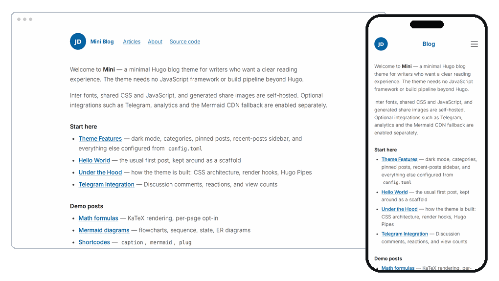

# Hugo Mini

[](https://github.com/zavarovkv/hugo-mini/releases)
[](https://github.com/zavarovkv/hugo-mini/actions/workflows/test-example-site.yml)
[](https://github.com/zavarovkv/hugo-mini/blob/main/LICENSE)

<p align="center">
  <a href="README.md">English</a> | <a href="README.ru.md">Русский</a>
</p>

A writer-first Hugo theme for fast, multilingual personal blogs.

Clean typography, self-hosted assets, dark mode, SEO, and optional Telegram integration — without a frontend framework.

The reading foundation comes from [Beauty.css](https://github.com/zavarovkv/beauty-css), pinned and
bundled locally with the theme's own styles. No additional installation is required.

**[Live demo](https://hugo-mini-demo.vercel.app/)** · **[Quick start](#quick-start)** · **[Hugo Themes](https://themes.gohugo.io/themes/hugo-mini/)** · **[Documentation](#documentation)**

[](https://hugo-mini-demo.vercel.app/)

## Why Mini

- **Made for reading.** The interface stays out of the way and gives articles room to breathe.
- **Fast by default.** CSS, JavaScript, and fonts are bundled, fingerprinted, and served from your domain.
- **Useful without a plugin stack.** Dark mode, multilingual navigation, feeds, search-engine metadata, math, diagrams, and sharing are included.
- **Easy to grow.** Design tokens, template hooks, named blocks, and custom menu icons cover common extensions.

Mini is for text-led blogs and personal sites, rather than magazine homepages or application-style interfaces.

## Quick start

**One-click starter on Vercel** — creates a new repository with an editable blog and deploys it automatically:

[](https://vercel.com/new/clone?repository-url=https%3A%2F%2Fgithub.com%2Fzavarovkv%2Fhugo-mini%2Ftree%2Fmain%2Fstarter&project-name=my-mini-blog&repository-name=my-mini-blog)

[View the starter files](starter/) · [How the one-click setup works](starter/README.md)

**Or set it up locally** with Hugo Extended 0.146 or newer:

```bash
hugo new site myblog
cd myblog
git init
git submodule add https://github.com/zavarovkv/hugo-mini.git themes/hugo-mini
```

Replace `hugo.toml` with a minimal configuration:

```toml
baseURL = "https://example.com/"
title = "My Blog"
theme = "hugo-mini"
enableRobotsTXT = true

[permalinks]
  blog = "/:slug/"

[params]
  authorName = "Jane Doe"
  authorURL = "https://example.com/"

[markup.goldmark.renderer]
  unsafe = true

[[menu.main]]
  name = "Articles"
  url = "/blog/"
  weight = 1
```

Create the blog section and your first article:

```bash
hugo new content blog/_index.md
hugo new content blog/hello-world.md
hugo server -D
```

Open `http://localhost:1313/`. For a ready-to-run reference, see the [example site](exampleSite/). Prefer Hugo Modules? See [installation options](docs/configuration.md#installation).

## What is included

| Area | Built in |
| --- | --- |
| Writing | Markdown, build-time typography, optional heading links and CSS classes, code copy, captions, KaTeX, Mermaid |
| Reading | Responsive 720 px reading measure, system-aware dark mode, print-friendly articles, recent posts, pinned posts |
| Discovery | Open Graph images, JSON-LD, `hreflang`, RSS, JSON Feed, `llms.txt` |
| Integrations | Telegram comments and reactions, social sharing, optional analytics |

Explore [content components and advanced options](docs/advanced-features.md). Features that add weight are opt-in. KaTeX and Mermaid load only on pages that request them; analytics and Telegram are absent until configured.

Without JavaScript, mobile navigation remains visible as ordinary links. The overlay initializes hidden without a loading flash, and closes on Escape, link selection or keyboard focus leaving the navigation. Opening and closing it preserves the article's scroll position.

The search shortcut is shown by default: an icon at the far right of the desktop navigation and a text-only "Search" link before the last mobile menu item. Both lead to the homepage until search is implemented. Set `showSearchButton = false` under `[params]` to hide the shortcut.

Mermaid diagrams render as they approach the viewport. Their source stays readable when JavaScript is disabled or loading fails. An optional local ESM bundle loads only the diagram types in use, with a content-hashed entry URL to invalidate stale browser caches after upgrades; see [configuration](docs/configuration.md). Local Markdown images receive intrinsic dimensions to reserve space while loading.

## Reading and typography

Articles use 16 px text and a reading measure of up to 720 px. The bundled
Beauty.css foundation handles typography; Hugo adds language-aware spacing for
Russian and English during the build, without changing Markdown files or running
text-rewriting JavaScript in the browser. Set `typography = false` to opt out.
See [reading and typography](docs/typography.md) for examples and fine-grained control.

## Everyday configuration

Most sites only need a few parameters:

```toml
[params]
  favicon = "images/favicon.png"
  avatar = "images/avatar.webp"
  avatarHover = "images/avatar-hover.webp"
  copyrightYear = 2024
  recentSidebarCount = 8
  socialSharing = true

  [params.social]
    telegram = "https://t.me/janedoe"
    github = "https://github.com/janedoe"
    email = "jane@example.com"
```

Posts use TOML front matter:

```toml
+++
title = "My first post"
date = 2026-08-17
description = "A short summary for listings and search results."
categories = ["notes"]
pinned = false
math = false
mermaid = false
+++
```

Set `hidden = true` to exclude a page from listings and feeds while keeping its
URL public; use Hugo's `draft = true` to keep it unpublished. Set
`date_precision = "month"` when only a publication month is known. See
[content options](docs/content.md) for visibility, canonical URLs, categories,
dates and printing.

Recent articles appear beside posts when space allows, or below them on narrow
screens; `recentSidebarCount = 0` hides the list. `backToTop = false` disables
the back-to-top control on a page or site-wide. See [configuration](docs/configuration.md)
for the complete parameter list and [customization](docs/customization.md) for
share cards, custom headers, footer links and other extension points.

Color choices stay local by default. To share theme and language preferences
between a site and its subdomains, see [preference sharing](docs/configuration.md#shared-theme-and-language-preferences).

## Optional integrations

- **Multilingual sites:** per-language menus, translated interface strings, `hreflang`, a footer switcher for two languages or a menu for three or more, and internal Markdown links to available translations. Set `localizeLinks = false` to keep their original destinations.
- **Telegram:** lazy-loaded comments plus build-time view and reaction counts.
- **Math and diagrams:** per-page KaTeX and Mermaid switches.
- **Analytics:** Yandex Metrika, Google Analytics, Plausible, and Umami; each is disabled unless configured.
- **Customization:** color tokens, custom SVG menu icons, partial hooks, and named layout blocks.

## Documentation

- [Configuration and multilingual setup](docs/configuration.md)
- [Writing and organizing content](docs/content.md)
- [Content components and advanced options](docs/advanced-features.md)
- [Vercel one-click starter](starter/)
- [Reading width and build-time typography](docs/typography.md)
- [Customizing the theme](docs/customization.md)
- [Telegram comments and reactions](docs/telegram.md)
- [Deployment](docs/deployment.md)
- [Maintaining vendored assets](docs/vendor-assets.md)
- [Changelog](CHANGELOG.md) · [Contributing](CONTRIBUTING.md)

Found a bug or have an idea? [Open an issue](https://github.com/zavarovkv/hugo-mini/issues).
If Mini helps you publish, a [GitHub star](https://github.com/zavarovkv/hugo-mini) makes it easier for other writers to discover the theme.

## License

[MIT](LICENSE)
