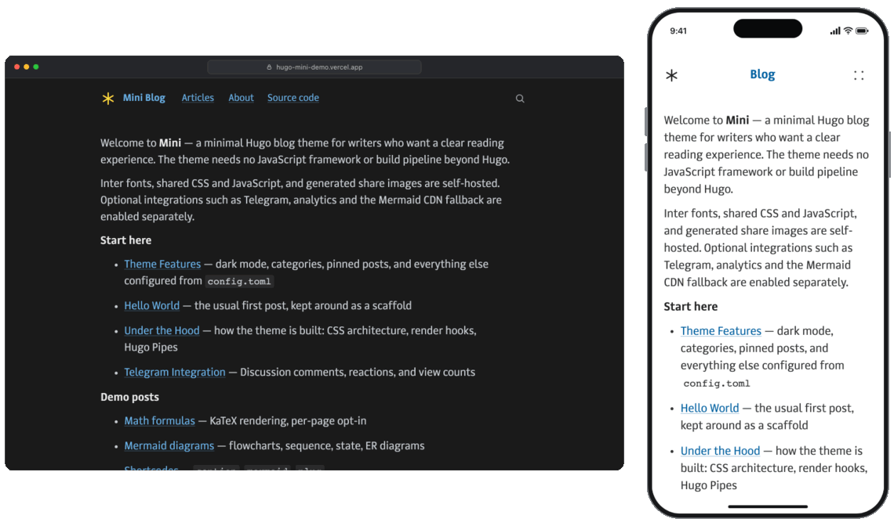

# Hugo Mini

[](https://github.com/zavarovkv/hugo-mini/releases)
[](https://github.com/zavarovkv/hugo-mini/actions/workflows/test-example-site.yml)
[](https://github.com/zavarovkv/hugo-mini/blob/main/LICENSE)

<p align="center">
  <a href="README.md">English</a> | <a href="README.ru.md">Русский</a>
</p>

**A minimal Hugo theme for personal blogs, essays and notes.**

Build with Hugo. Core fonts, styles and scripts are served from your own site.

**[Live demo](https://hugo-mini-demo.vercel.app/)** · **[Quick start](#quick-start)** · **[Hugo Themes](https://themes.gohugo.io/themes/hugo-mini/)** · **[Documentation](#documentation)**

[](https://hugo-mini-demo.vercel.app/)

Bundled font: **Inter**. The demo uses separately licensed Story, Sourdine and Mirta fonts. [Font details](docs/demo.md#deployment-owned-demo-fonts).

## Features

- **Typography for reading.** [Beauty.css](https://github.com/zavarovkv/beauty-css), quotations, footnotes, optional margin notes and print styles. [See examples](docs/typography.md).
- **Full-text search.** Optional [Pagefind search](docs/search.md), built with the site: relevant snippets, keyboard navigation and language-specific results.
- **Easy navigation.** Mobile menus, light/dark mode and keyboard shortcuts. Multilingual sites with English and Russian UI included.
- **Rich articles.** Code highlighting and copying, KaTeX formulas, Mermaid diagrams and wide images.
- **Ready to share.** SEO metadata, generated social preview images, RSS, JSON Feed and sitemap.
- **Beyond the blog.** Homepage blocks, featured posts, projects, reading lists and a [printable CV](docs/resume.md).
- **Your own style.** Custom colors, fonts and logos. Optional Telegram comments, sharing buttons and analytics.

## Quick start

Requires **[Hugo Extended 0.146+](https://gohugo.io/installation/)** and **Git**. The search-enabled starter also needs **Node.js 22.12+**; sites without search can build with Hugo alone.

Create a blog with a sample homepage, About page and first post:

```bash
hugo new site myblog
cd myblog
git init
git submodule add https://github.com/zavarovkv/hugo-mini.git themes/hugo-mini
cp themes/hugo-mini/starter/hugo.toml hugo.toml
cp -R themes/hugo-mini/starter/content/. content/
cp themes/hugo-mini/starter/package*.json .
npm ci
npm run dev
```

Open `http://localhost:1313/`. Set your title and author in `hugo.toml`; replace the sample pages in `content/`.

Stop the server with `Ctrl+C`, then create a post and preview drafts:

```bash
hugo new content blog/my-first-post.md
npm run dev -- --buildDrafts
```

To publish, stop the server, set your `baseURL`, change the post's `draft` to `false`, run `npm run build` and deploy `public/` to a static host. [Deployment guide](docs/deployment.md).

**Prefer Vercel?** Deploy the [starter](starter/README.md) into your own repository:

[](https://vercel.com/new/clone?repository-url=https%3A%2F%2Fgithub.com%2Fzavarovkv%2Fhugo-mini%2Ftree%2Fmain%2Fstarter&project-name=my-mini-blog&repository-name=my-mini-blog)

Existing site or Hugo Modules? See [installation](docs/configuration.md#installation). For later changes, follow the [update guide](docs/configuration.md#updating).

## Documentation

[Documentation home](docs/README.md) · [Feature index](docs/advanced-features.md)

- [Configuration & languages](docs/configuration.md) · [Example site](exampleSite/)
- [Writing & components](docs/content.md) · [Typography](docs/typography.md)
- [Customization](docs/customization.md) · [Fonts](docs/fonts.md) · [Telegram](docs/telegram.md)
- [Bundled assets](docs/vendor-assets.md) · [Changelog](CHANGELOG.md)

[Report an issue](https://github.com/zavarovkv/hugo-mini/issues) · [Contribute](CONTRIBUTING.md)

## License

[MIT](LICENSE)
