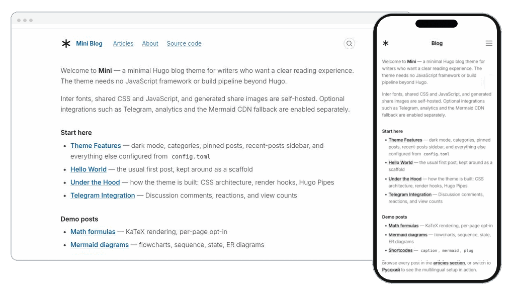

# Hugo Mini

[](https://github.com/zavarovkv/hugo-mini/releases)
[](https://github.com/zavarovkv/hugo-mini/actions/workflows/test-example-site.yml)
[](https://github.com/zavarovkv/hugo-mini/blob/main/LICENSE)

<p align="center">
  <a href="README.md">English</a> | <a href="README.ru.md">Русский</a>
</p>

**Минималистичная тема Hugo для личных блогов.** Меньше настроек — больше времени на тексты.

Аккуратная типографика на основе [Beauty.css](https://github.com/zavarovkv/beauty-css), удобное чтение на любом экране, светлое и темное оформление. Несколько языков, SEO, RSS и JSON Feed доступны сразу. Для сборки нужен только Hugo: без Node.js и обязательных внешних сервисов.

**[Демо](https://hugo-mini-demo.vercel.app/)** · **[Быстрый старт](#быстрый-старт)** · **[Каталог тем Hugo](https://themes.gohugo.io/themes/hugo-mini/)** · **[Документация](#документация)**

[](https://hugo-mini-demo.vercel.app/)

## Почему Mini

- **Текст на первом месте.** Колонка до 720 px, автоматическая правка кавычек, тире и неразрывных пробелов при сборке. Markdown не меняется. [Примеры](docs/typography.ru.md).
- **Ничего лишнего.** Адаптивная верстка; шрифты, стили и скрипты загружаются с вашего сайта.
- **Все для публикации.** Светлая и темная темы, фавиконка, несколько языков, SEO, RSS и JSON Feed.
- **Только нужные функции.** Настройка цветов, меню и логотипа; формулы, диаграммы, комментарии Telegram, кнопки «Поделиться» и аналитика — по желанию.

## Быстрый старт

**Разверните блог на Vercel в один клик:**

[](https://vercel.com/new/clone?repository-url=https%3A%2F%2Fgithub.com%2Fzavarovkv%2Fhugo-mini%2Ftree%2Fmain%2Fstarter&project-name=my-mini-blog&repository-name=my-mini-blog)

[Файлы шаблона](starter/) · [Инструкция](starter/README.md)

**Запустите локально** с Hugo Extended версии 0.146 или новее:

```bash
hugo new site myblog
cd myblog
git init
git submodule add https://github.com/zavarovkv/hugo-mini.git themes/hugo-mini
```

Замените содержимое `hugo.toml` на:

```toml
baseURL = "https://example.com/"
title = "My Blog"
theme = "hugo-mini"

[[menu.main]]
  name = "Blog"
  url = "/blog/"
  weight = 1
```

Создайте первую статью и запустите сервер:

```bash
hugo new content blog/_index.md
hugo new content blog/hello-world.md
hugo server -D
```

Откройте `http://localhost:1313/`. Смотрите [пример сайта](exampleSite/) и [установку через Hugo Modules](docs/configuration.md#installation).

## Документация

Руководства:

- [Установка и языки](docs/configuration.md) · [Публикация сайта](docs/deployment.md) · [Написание статей](docs/content.md)
- [Типографика](docs/typography.ru.md) · [Настройка темы](docs/customization.md) · [Дополнительные возможности](docs/advanced-features.md)
- [Telegram](docs/telegram.md) · [Ресурсы темы](docs/vendor-assets.md) · [История изменений](CHANGELOG.md)

[Сообщить об ошибке](https://github.com/zavarovkv/hugo-mini/issues) · [Участвовать в разработке](CONTRIBUTING.md) · [Поставить звезду на GitHub](https://github.com/zavarovkv/hugo-mini)

## Лицензия

[MIT](LICENSE)
