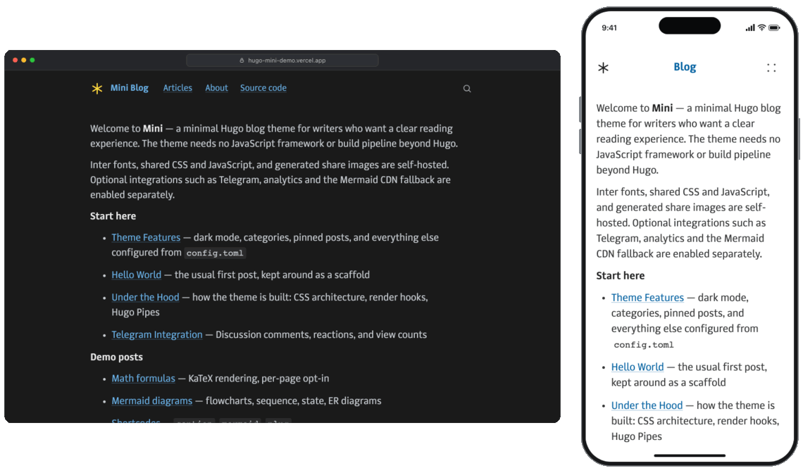

# Hugo Mini

[](https://github.com/zavarovkv/hugo-mini/releases)
[](https://github.com/zavarovkv/hugo-mini/actions/workflows/test-example-site.yml)
[](https://github.com/zavarovkv/hugo-mini/blob/main/LICENSE)

<p align="center">
  <a href="README.md">English</a> | <a href="README.ru.md">Русский</a>
</p>

**Тема Hugo для личных блогов, эссе и заметок.** Пишите в Markdown и публикуйте статический сайт. Шрифты, стили и основной JavaScript загружаются с вашего домена.

**[Демо](https://hugo-mini-demo.vercel.app/ru/)** · **[Быстрый старт](#быстрый-старт)** · **[Каталог тем Hugo](https://themes.gohugo.io/themes/hugo-mini/)** · **[Документация](#документация)**

[](https://hugo-mini-demo.vercel.app/ru/)

В комплекте **Inter**. В публичном демо основной текст набран Стори, заголовки статей — Сурдином, цитаты — Миртой. У этих шрифтов отдельные лицензии. [Шрифты демо](docs/demo.md#deployment-owned-demo-fonts)

## Возможности

- **Чтение.** Типографика [Beauty.css](https://github.com/zavarovkv/beauty-css), цитаты, сноски на полях, опциональное оглавление для статей с двумя и более H2 на широких экранах и версия для печати. [Примеры оформления](docs/typography.ru.md)
- **Статьи и главная.** Код с подсветкой и копированием, формулы KaTeX, диаграммы Mermaid и широкие иллюстрации с подписями по центру. На главной можно собрать подборку статей, проекты и список книг.
- **Навигация.** В мобильном меню и подвале можно сменить язык или цветовую тему и открыть соцссылки. Есть клавиатурные сочетания, русский и английский интерфейсы.
- **Поиск.** [Pagefind](docs/search.md) ищет по тексту на языке страницы. В стартере поиск включен, индекс обновляется при сборке.
- **Публикация.** Карта сайта, RSS и карточки для соцсетей. По желанию подключаются JSON Feed, комментарии Telegram, кнопки «Поделиться» и аналитика.

## Быстрый старт

Нужны **[Hugo Extended 0.146+](https://gohugo.io/installation/)** и **Git**. Готовый шаблон с поиском также требует **Node.js 22.12+**. Для сайта без поиска достаточно Hugo и установленной темы.

Создайте блог с примерами главной страницы, страницы об авторе и первой статьи:

```bash
hugo new site myblog
cd myblog
git init
git submodule add https://github.com/zavarovkv/hugo-mini.git themes/hugo-mini
cp themes/hugo-mini/starter/hugo.toml hugo.toml
cp -R themes/hugo-mini/starter/content/. content/
cp themes/hugo-mini/starter/package*.json .
npm ci
npm run dev
```

Откройте `http://localhost:1313/`. Укажите название блога и автора в `hugo.toml`, замените примеры страниц в `content/`.

Чтобы создать первую статью и увидеть черновик, остановите сервер сочетанием `Ctrl+C` и выполните команды ниже.

```bash
hugo new content blog/my-first-post.md
npm run dev -- --buildDrafts
```

Для публикации задайте `baseURL`, выставьте у статьи `draft = false` и выполните `npm run build`. Загрузите на хостинг весь каталог `public/` вместе с индексом поиска. [Инструкция по публикации](docs/deployment.md).

**Предпочитаете Vercel?** Разверните [готовый шаблон](starter/README.md) в своем репозитории:

[](https://vercel.com/new/clone?repository-url=https%3A%2F%2Fgithub.com%2Fzavarovkv%2Fhugo-mini%2Ftree%2Fmain%2Fstarter&project-name=my-mini-blog&repository-name=my-mini-blog)

Уже есть сайт или используете Hugo Modules? Смотрите [установку](docs/configuration.md#installation). Для установленной темы есть [инструкция по обновлению](docs/configuration.md#updating) и [переходу с v3 на v4](docs/configuration.md#upgrade-from-v3-to-v4).

## Документация

[Все руководства](docs/README.md) · [Указатель возможностей](docs/advanced-features.md)

- [Настройки и языки](docs/configuration.md) · [Пример сайта](exampleSite/)
- [Статьи и компоненты](docs/content.md) · [Типографика](docs/typography.ru.md)
- [Настройка темы](docs/customization.md) · [Шрифты](docs/fonts.md) · [Telegram](docs/telegram.md)
- [Ресурсы темы](docs/vendor-assets.md) · [История изменений](CHANGELOG.md)

[Сообщить об ошибке](https://github.com/zavarovkv/hugo-mini/issues) · [Участвовать в разработке](CONTRIBUTING.md)

## Лицензия

[MIT](LICENSE)
